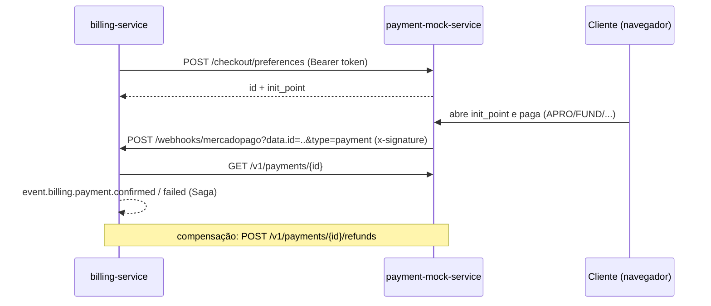

# Payment Mock Service — simulador do Mercado Pago

Serviço independente que **imita a API do Mercado Pago** (Checkout Pro) usada pelo `billing-service`.
O Billing fala com ele pela **mesma integração HTTP** que usaria com o Mercado Pago real. Para trocar de um para o outro,
basta mudar `MP_API_BASE_URL` e `MP_ACCESS_TOKEN`, sem alterar código.

| Item | Valor |
|---|---|
| Porta | `8084` |
| Estado | Em memória (como um sandbox de provedor externo: o dado que importa fica persistido no Billing) |
| Swagger | `http://localhost:8084/swagger-ui.html` |
| Autenticação | `Authorization: Bearer {MOCK_ACCESS_TOKEN}` nas rotas de API (igual ao Mercado Pago) |

## Contrato imitado
| Mercado Pago | Simulador | Observação |
|---|---|---|
| `POST /checkout/preferences` | ✅ | Calcula o total pelos `items`; devolve `id`, `init_point`, `sandbox_init_point` |
| `GET /checkout/preferences/{id}` | ✅ | |
| `GET /v1/payments/{id}` | ✅ | `status`, `status_detail`, `external_reference`, `transaction_amount`, `refunds`... |
| `POST /v1/payments/{id}/refunds` | ✅ | Estorno total, idempotente por `X-Idempotency-Key` |
| Página de checkout (`init_point`) | ✅ `/checkout/v1/redirect?pref_id=` | O comprador escolhe o resultado; volta para `back_urls` com `collection_status`, `payment_id`... |
| Webhook (notificações) | ✅ | `POST {notification_url}?data.id={id}&type=payment`, corpo `{"action":"payment.created","type":"payment","data":{"id"}}`, headers **`x-signature`** (HMAC-SHA256 `id:…;request-id:…;ts:…;`) e `x-request-id`; 3 tentativas com backoff |
| Erros | ✅ | `{"message","error","status","cause"}` |

### Resultados de pagamento
Inspirados nos nomes de titular dos [cartões de teste do Mercado Pago](https://www.mercadopago.com.br/developers/pt/docs/checkout-pro/additional-content/your-integrations/test/cards):

| Código | status | status_detail |
|---|---|---|
| `APRO` | approved | accredited |
| `FUND` | rejected | cc_rejected_insufficient_amount |
| `OTHE` | rejected | cc_rejected_other_reason |
| `CONT` | in_process | pending_contingency |

### Endpoints auxiliares (não existem no Mercado Pago)
- `POST /api/mock/checkout/{preferenceId}/pay` `{"outcome":"APRO"}`: paga sem abrir o navegador (Postman/e2e).
- `GET /api/mock/payments`: pagamentos e histórico de entregas do webhook (tentativa, HTTP status, erro).
- `POST /api/mock/payments/{id}/notify`: reenvia o webhook.

## Fluxo com o Billing



## Configuração (`.env`)
| Variável | Descrição |
|---|---|
| `MOCK_ACCESS_TOKEN` | Token aceito pela API. **Mesmo valor** de `MP_ACCESS_TOKEN` no Billing |
| `MOCK_WEBHOOK_SECRET` | Segredo da assinatura `x-signature`. **Mesmo valor** de `MP_WEBHOOK_SECRET` no Billing |
| `MOCK_PUBLIC_BASE_URL` | URL do simulador vista pelo navegador (monta o `init_point`) |

## Executar e testar
```bash
cp .env.example .env
./mvnw verify            # testes + JaCoCo (gate 80%)
./mvnw spring-boot:run
```
**Evidência de cobertura (JaCoCo):** 13 testes, **98,1% de linhas**, 89,2% de branches. Inclui a verificação da assinatura
HMAC, as novas tentativas do webhook e o fluxo HTTP completo (preferência → checkout → pagamento → estorno).
CI/CD em `.github/workflows/ci-cd.yml` (build, testes, SonarCloud, imagem GHCR e deploy Kubernetes) e manifestos em `k8s/`.
